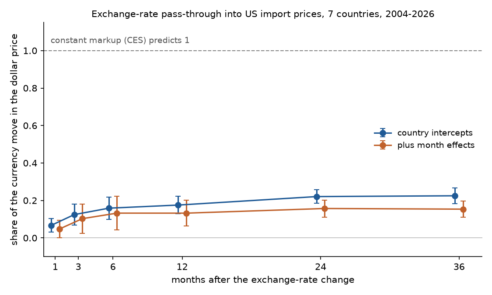
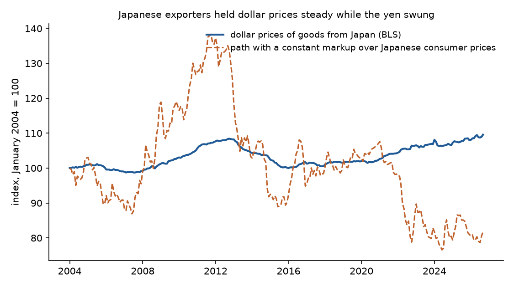

# When the Yen Fell, Prices Stayed Put

### In 1976 and 1977, Michael Spence, Avinash Dixit and Joseph Stiglitz built the model of monopolistic competition in which every seller keeps a fixed markup over its costs. I checked that markup against nearly twenty-three years of American import prices.

---

In January 2021 a dollar bought 103.79 yen. By June 2024 it bought 157.86. For a company that pays its workers, its suppliers and its factory bills in yen, a million yen of cost shrank over those three years and five months from $9,635 to $6,335 when counted in dollars. Toyota, Honda, Subaru and Mazda all ship cars built in Japan to American dealers, alongside the machinery, parts and electronics of thousands of smaller Japanese firms, and Japanese consumer prices rose 8.3% over the same stretch, so a company that kept the same markup over its yen costs would have cut its dollar prices by about 29%.

They did nothing of the kind. The Bureau of Labor Statistics tracks the dollar prices American importers pay for goods shipped from Japan, and over those same months its index rose 3.6%. Measured against Japanese consumer prices, almost the entire windfall from the weaker yen stayed with the sellers as a wider margin. That is a direct problem for the most widely used model of pricing power in economics, one in which every seller charges a fixed multiple of its cost no matter what happens to its costs, its rivals or the currency.

---

## A markup that never moves

A seller's markup is the ratio of its price to the cost of making one more unit. The model that Spence, Dixit and Stiglitz built gives each seller a product slightly different from everyone else's and a demand curve with the same constant price elasticity $`\sigma`$, the percentage drop in sales from a one percent price increase. Under that demand the profit-maximizing price is

```math
p = \frac{\sigma}{\sigma - 1}\, c ,
```

where $`p`$ is the price and $`c`$ is marginal cost. The markup depends only on how easily buyers switch between varieties, so it is the same for every seller and stays put when cost changes.

| How easily buyers switch | Elasticity $`\sigma`$ | Markup $`p/c`$ |
|---|---|---|
| Very loyal buyers | 2 | 2.00 |
| Moderately loyal buyers | 5 | 1.25 |
| Buyers who treat every variety as identical | approaching infinity | approaching 1.00 |

The measure I use to test this is pass-through, the share of a change in cost that shows up in price. A foreign seller's costs are in its own currency, so its dollar cost is $`c^{*}E`$, where $`c^{*}`$ is cost in yen, euros or pesos and $`E`$ is the number of dollars one unit of that currency buys. Pass-through of the exchange rate is

```math
\beta = \frac{\Delta \ln p^{\$}}{\Delta \ln E},
```

the percentage change in the dollar price for each one percent change in the value of the seller's currency. With a fixed markup, $`\beta = 1`$. Over the yen's slide from January 2021 to June 2024, the yen lost 34.25% of its dollar value and Japanese consumer prices rose 8.30%, so

```math
\begin{aligned}
\Delta \ln p^{\$}_{\text{fixed markup}} &= \ln(1 - 0.3425) + \ln(1.0830) = -0.340 \\
\Delta \ln p^{\$}_{\text{actual}} &= \ln(1.0359) = +0.035
\end{aligned}
```

A fixed markup over yen costs called for a 28.8% price cut and the actual dollar price rose 3.6%.

---

## Spence, Dixit and Stiglitz's question

Michael Spence was born in Montclair, New Jersey, in 1943 and went to school in Toronto. He studied at Princeton and, as a Rhodes Scholar, at Oxford, and earned his doctorate at Harvard in 1972. In June 1976 the *Review of Economic Studies* published his "Product Selection, Fixed Costs, and Monopolistic Competition." A year later the *American Economic Review* published "Monopolistic Competition and Optimum Product Diversity" by Avinash Dixit, then at the University of Warwick, and Joseph Stiglitz, then at Stanford. Dixit and Stiglitz thanked Spence in the paper's opening footnote and wrote that their results were very similar to his, the main difference being that Spence studied one industry on its own while they let spending move between that industry and the rest of the economy. Spence and Stiglitz later shared the 2001 Nobel memorial prize in economics with George Akerlof, for work on markets where one side knows more than the other. Spence taught at Harvard and Stanford and ran Stanford's business school in the 1990s.

Their question was an old one. When every product has a fixed cost of getting started, a market can't price everything at marginal cost, because nobody would cover the fixed cost. Some pricing power is needed, and the question is whether the variety the market ends up with, the number of different products and how much of each gets made, is too much, too little or about right. Edward Chamberlin had argued in 1933 that such markets carry too many sellers, each working below its efficient scale. Dixit and Stiglitz challenged that, writing that a "vague presumption" of excessive diversity had built up among economists. In their constant-elasticity case the market price, $`p_e = c/\rho`$ in their notation (equation 15, where $`\sigma = 1/(1-\rho)`$), is exactly the price a planner would pick if it had to let every firm break even (equation 22). A planner free to subsidize would choose more products, not fewer (equation 30). They also found the market biased against goods that a few people value intensely, giving the example of a bias "against opera relative to football matches."

The welfare results depend on details. The pricing rule that made the model easy to use is what traveled. Paul Krugman's models of trade and nearly every New Keynesian model of inflation rest on it, because it lets an economist describe an industry of thousands of differentiated sellers with a single number. The rule follows from four assumptions. Seller $`i`$ faces demand $`q_i = A\,p_i^{-\sigma}`$ with $`\sigma > 1`$, where $`A`$ bundles total spending and the industry price level, which one seller among many takes as given. Its marginal cost $`c_i`$ is constant. It picks price to maximize profit. Its cost in dollars is $`c_i^{*}E`$. Then

```math
\begin{aligned}
\pi_i &= (p_i - c_i)\,A\,p_i^{-\sigma} \\
\frac{\partial \pi_i}{\partial p_i} &= A\,p_i^{-\sigma}\left[1 - \sigma\,\frac{p_i - c_i}{p_i}\right] = 0 \\
p_i &= \frac{\sigma}{\sigma - 1}\,c_i \\
\ln p_i^{\$} &= \ln\frac{\sigma}{\sigma-1} + \ln c_i^{*} + \ln E \\
\frac{d \ln p_i^{\$}}{d \ln E} &= 1
\end{aligned}
```

Whatever happens to cost happens one for one to price.

Dixit and Stiglitz knew this was special. The second section of their paper lets the demand elasticity vary with the quantity sold, and the price rule becomes $`p_e = c[1 + \beta(x_e)]`$, a markup that changes with conditions. The strongest objection since has built on that idea. Miles Kimball in 1995, and Andrew Atkeson and Ariel Burstein in 2008, built models in which a seller loses customers faster the further its price rises above its rivals', so it shades its markup to stay close to them. Write $`\mu`$ for the markup, $`P`$ for the rivals' price level and $`\Gamma`$ for how fast the markup falls as the seller's relative price $`p/P`$ rises. Then

```math
\begin{aligned}
\ln p &= \ln \mu(p/P) + \ln c \\
d\ln p &= -\Gamma\,(d\ln p - d\ln P) + d\ln c \\
d\ln p &= \frac{1}{1+\Gamma}\,d\ln c + \frac{\Gamma}{1+\Gamma}\,d\ln P
\end{aligned}
```

Pass-through falls to $`1/(1+\Gamma)`$, and rivals' prices get the remaining weight. The constant-markup model is the case $`\Gamma = 0`$. Defenders of the original reply that it was built to answer questions about variety and the gains from trade, where a fixed markup is a harmless simplification. Critics reply that the same model now sits inside the models central banks use to forecast how a weaker currency or a tariff feeds into inflation, where whether markups move is the whole question.

---

## How I tested it

The Bureau of Labor Statistics publishes monthly import price indexes by country of origin, measuring the dollar prices American importers pay at the border. I used seven large origins with long monthly series, namely Japan, Germany, France, the United Kingdom, Canada, Mexico and China, from January 2004 (four of the indexes begin in December 2003) to September 2026. October 2025, the month of the federal government shutdown, is missing from every BLS import index, so changes that start or end in that month drop out. For Canada and Mexico I used the index for manufactured goods, so that crude oil, priced in dollars worldwide, does not swamp the test. Exchange rates are the Federal Reserve's monthly averages. The theory's $`c^{*}`$ is a firm's marginal cost in its own currency, which no public source reports, so I stood in each country's consumer price index from the Bank for International Settlements.

For each horizon $`h`$ of 1, 3, 6, 12, 24 and 36 months, I regressed the change in the log import price on the change in the log exchange rate and the change in log home prices,

```math
\Delta_h \ln p_{c,t} = \alpha_c + \beta_h\,\Delta_h \ln E_{c,t} + \gamma_h\,\Delta_h \ln P^{*}_{c,t} + \varepsilon_{c,t},
\qquad H_0:\ \beta_h = 1,
```

where $`c`$ indexes the origin country, $`t`$ the month, $`\alpha_c`$ is a country intercept, $`P^{*}`$ is the home consumer price index and $`\varepsilon`$ is the error. The long differences overlap, so I computed Driscoll–Kraay standard errors with $`h + 2`$ lags, which allow for correlation across countries within a month and across months within a country. A second version adds a dummy for every month, so that only currencies moving against one another identify $`\beta_h`$. Country-by-country regressions use Newey–West errors with the same lag length. The constant-markup model predicts $`\beta_h = 1`$ and $`\gamma_h = 1`$ at every horizon, or at least at long ones once sticky prices have had time to adjust.

---

## Foreign sellers pass on about a fifth of a currency move

| Months after the change | Pass-through $`\hat\beta_h`$ | 95% interval | With month effects |
|---|---|---|---|
| 1 | 0.07 | 0.03 to 0.10 | 0.05 |
| 3 | 0.12 | 0.07 to 0.18 | 0.10 |
| 6 | 0.16 | 0.10 to 0.22 | 0.13 |
| 12 | 0.18 | 0.13 to 0.22 | 0.13 |
| 24 | 0.22 | 0.18 to 0.26 | 0.16 |
| 36 | 0.22 | 0.18 to 0.27 | 0.15 |

At two years,

```math
\hat\beta_{24} = 0.221\;(0.019),\quad 95\%\ \text{CI}\ [0.184,\ 0.257],\quad N = 1{,}677,
```

and the hypothesis $`\beta_{24} = 1`$ is rejected with $`p < 0.001`$. When a country's currency rises 10% against the dollar, the dollar price of its goods rises by about 2.2% over the next two years, and the sellers' margins absorb the rest. Read through the variable-markup formula, a pass-through of 0.221 implies $`\hat\Gamma = (1 - 0.221)/0.221 = 3.53`$, a markup that falls by about 3.5% for each 1% that a seller's price rises relative to its rivals'.



The usual defense of the fixed markup is that prices are sticky in the short run, especially for goods invoiced in dollars, and that pass-through should climb toward one as contracts and catalogs are rewritten. The data give that defense very little. Pass-through rises from 0.07 in the first month to 0.18 at one year and 0.22 at two years, and a third year adds almost nothing (0.225 against 0.221). The result holds in both halves of the sample, at 0.24 for 2004 to 2014 and 0.19 for 2015 to 2026 at the two-year horizon, and at 0.23 with China, whose currency the government manages, left out. Identifying only from currencies moving against each other lowers it to 0.16.

---

## Every country falls short, Japan and Mexico furthest

The table takes each country's largest 24-month swing against the dollar since 2004 and sets what a fixed markup predicted beside what happened. The companies named are each country's best-known exporters to the United States, given for orientation, since the price indexes do not identify firms.

| Origin | Best-known exporters | 2025 US imports | Largest swing | Currency move | Fixed markup predicted | Actual dollar price change | Two-year pass-through |
|---|---|---|---|---|---|---|---|
| Mexico | Car and truck plants of GM, Nissan, Volkswagen | $534 billion | Nov 2014 to Nov 2016 | −32.0% | −28.1% | −6.3% | 0.09 |
| Canada | Ontario car plants, Bombardier | $382 billion | Jan 2014 to Jan 2016 | −23.0% | −20.7% | −11.4% | 0.57 |
| China | Foxconn's iPhone assembly, Lenovo | $309 billion | Jul 2006 to Jul 2008 | +16.9% | +31.3% | +6.3% | 0.18 |
| Germany | BMW, Mercedes-Benz, Volkswagen, Siemens | $156 billion | Mar 2006 to Mar 2008 | +29.0% | +35.6% | +9.2% | 0.14 |
| Japan | Toyota, Honda, Subaru, Mazda | $146 billion | Nov 2012 to Nov 2014 | −30.3% | −27.5% | −4.4% | 0.11 |
| France | Airbus, LVMH, L'Oréal | $68 billion | Mar 2006 to Mar 2008 | +29.0% | +34.7% | +12.5% | 0.15 |
| United Kingdom | Rolls-Royce, Jaguar Land Rover, Diageo | $65 billion | Mar 2007 to Mar 2009 | −27.2% | −23.3% | +0.6% | 0.30 |

*Currency move is the change in the dollar value of the country's currency. The predicted change adds home consumer-price inflation over the window. Two-year pass-through is the country's own regression estimate over 2004–2026.*

Japan's swing came as Prime Minister Shinzo Abe's economic program began, and the yen lost 30% of its dollar value. A fixed markup called for dollar prices 27.5% lower. They fell 4.4%. The figure below runs the same comparison over the whole period, and the pattern repeats in 2021 to 2024. The fixed-markup line swings between 77 and 138 on an index that starts at 100 in January 2004, and the actual dollar price index never leaves the range of 98 to 110.



Canada is the one country where pass-through gets above one half, at 0.57 after two years. Much of Canada's manufacturing trade with the United States runs through supply chains that cross the border several times, as in the car industry, and a seller that buys many of its inputs in American dollars has costs that track the American dollar more closely than its home price index suggests. The UK swing ran through the 2008 financial crisis, and over it dollar prices of British goods rose slightly while the pound lost more than a quarter of its value.

---

## Import prices follow American rivals' prices

The variable-markup account makes a second prediction that the fixed markup rules out. If foreign sellers shade their markups to stay close to their competitors, the dollar prices of their goods should move with what American producers charge, even holding the exchange rate and their own costs fixed. Following the decomposition of Mary Amiti, Oleg Itskhoki and Jozef Konings (2019), I added the change in the producer price index for American manufacturing, $`\Delta_h \ln P^{US}_{t}`$, to the regression with weight $`\delta_h`$. The constant-markup model predicts $`\delta_h = 0`$. The variable-markup formula predicts that the weights on own cost and rivals' prices add up to one, $`\beta_h + \delta_h = 1`$.

| 24-month changes | Estimate | Standard error | Constant markup predicts | Variable markup predicts |
|---|---|---|---|---|
| Exchange rate, $`\hat\beta`$ | 0.156 | 0.013 | 1 | $`1-\delta`$ |
| Home consumer prices, $`\hat\gamma`$ | 0.356 | 0.056 | 1 | $`1-\delta`$ |
| American producer prices, $`\hat\delta`$ | 0.326 | 0.028 | 0 | positive |
| $`\hat\beta + \hat\delta`$ | 0.483 | 0.032 | 1 | 1 |

In formal terms,

```math
\hat\delta_{24} = 0.326\;(0.028),\qquad \hat\beta_{24} + \hat\delta_{24} = 0.483\;(0.032),\qquad N = 1{,}677 .
```

Both restrictions are rejected with $`p < 0.001`$. A 10% rise in American factory prices raises the dollar prices of imports from these seven countries by about 3.3% over two years with no change in exchange rates, which the constant-markup model says cannot happen. The weights also add up to less than one, short of what the simplest variable-markup model requires. Using the price index for industrial goods excluding fuel instead gives $`\hat\delta = 0.240`$ and the same two rejections. Country by country, the American price weight is largest for Canada (1.33) and the United Kingdom (0.66), small and statistically insignificant for France and Mexico, and around 0.2 for Japan, Germany and China. On balance the data lean toward sellers who watch their rivals, with something still missing, perhaps a better measure of exporters' costs than a consumer price index.

---

## Why it matters

For consumers, a fixed markup would mean that a stronger dollar makes imported cars, cameras and wine cheaper almost at once and in full. The data say most of the gain from a stronger dollar goes to foreign sellers' margins instead, and that a weaker dollar raises import prices by much less than the currency move, so shoppers are partly insulated in both directions.

For workers and American manufacturers, the extension cuts two ways. Foreign sellers who price off their American rivals do not undercut them by the full amount when the dollar strengthens, which softens the blow to factories competing with imports. The same behavior means that when American producers raise prices, importers tend to follow rather than take market share.

For foreign exporters, the yen episode shows how much a currency swing can move profits. Measured against Japanese consumer prices, the markup on goods from Japan widened by about 45% between January 2021 and June 2024, and by about 32% in the Abe-era swing. The same arithmetic runs the other way when a currency strengthens. As the euro rose 29% against the dollar from March 2006 to March 2008, the implied markups on German and French goods fell by about 19% and 17%.

For policy, the result matters wherever the Spence–Dixit–Stiglitz pricing rule is built into a forecast. Models of tariff incidence, of exchange-rate effects on inflation and of monetary policy that assume a fixed markup will overstate how fast and how fully cost shocks reach prices. That includes the tariff increases of 2025, whose effect on prices depends on the same question of whether sellers absorb a cost change or pass it on.

---

## Limits of this study

The theory concerns marginal cost, and I measure it with a consumer price index, which includes rent, services and imported goods and leaves out the dollar-priced parts and materials that many exporters buy. When part of a Japanese carmaker's costs are in dollars, a cheaper yen lowers its dollar costs by less than the full currency move, and some of the shortfall in pass-through is then cost, not markup. The indexes are averages over thousands of products and firms, so they cannot show which sellers adjust markups and which do not, and the changing mix of products inside an index can move it. The border prices also include some trade between branches of the same multinational, priced for tax reasons. The extension uses one national producer price index for every country's goods rather than a measure of each country's direct American competitors. And the regressions show associations over 2004 to 2026, not a controlled experiment, though exchange-rate swings of the size studied here are mostly driven by forces far from any single industry.

---

## Further reading

- [TECHNICAL.md](TECHNICAL.md) has the data, the rules fixed before the results, every test statistic and how to reproduce them.
- [results/FINDINGS.md](results/FINDINGS.md) summarizes the results and reproduces every table the scripts write.
- [METHODS_REVIEW.md](METHODS_REVIEW.md) is a methods and reporting review of the original papers.
- A. Michael Spence, "Product Selection, Fixed Costs, and Monopolistic Competition," *Review of Economic Studies* 43(2), June 1976, pp. 217–235.
- Avinash K. Dixit and Joseph E. Stiglitz, "Monopolistic Competition and Optimum Product Diversity," *American Economic Review* 67(3), June 1977, pp. 297–308.
- Andrew Atkeson and Ariel Burstein, "Pricing-to-Market, Trade Costs, and International Relative Prices," *American Economic Review* 98(5), 2008.
- Mary Amiti, Oleg Itskhoki and Jozef Konings, "International Shocks, Variable Markups, and Domestic Prices," *Review of Economic Studies* 86(6), 2019.
- Import price indexes by locality of origin, US Bureau of Labor Statistics, via FRED (series JPNTOT, GERTOT, FRNTOT, UKTOT, CANMANU, MEXMANU, CHNTOT, EECMANU).
- Monthly exchange rates, Federal Reserve Board H.10 release, via FRED (EXJPUS, EXUSEU, EXUSUK, EXCAUS, EXMXUS, EXCHUS).
- Consumer prices, Bank for International Settlements long CPI series (WS_LONG_CPI).
- Producer price indexes PCUOMFG--OMFG-- and WPU03THRU15, US Bureau of Labor Statistics public data API.
- US goods trade by partner country, US Census Bureau (country.xlsx).

*Brendyn Beasley*
